# MANTA 🐋

### Marine Autonomous Neutralization & Tracking Array

**MANTA** is a speculative design concept for an ocean restoration platform that transforms whale migration into a living network for monitoring and localized intervention against ocean acidification.

> *The ocean already has its guardians. We simply help them protect it.*

🌐 **[View the project website](https://preksha-05.github.io/M.A.N.T.A---MARINE-AUTONOMOUS-NEUTRALIZATION-TRACKING-ARRAY-/)**

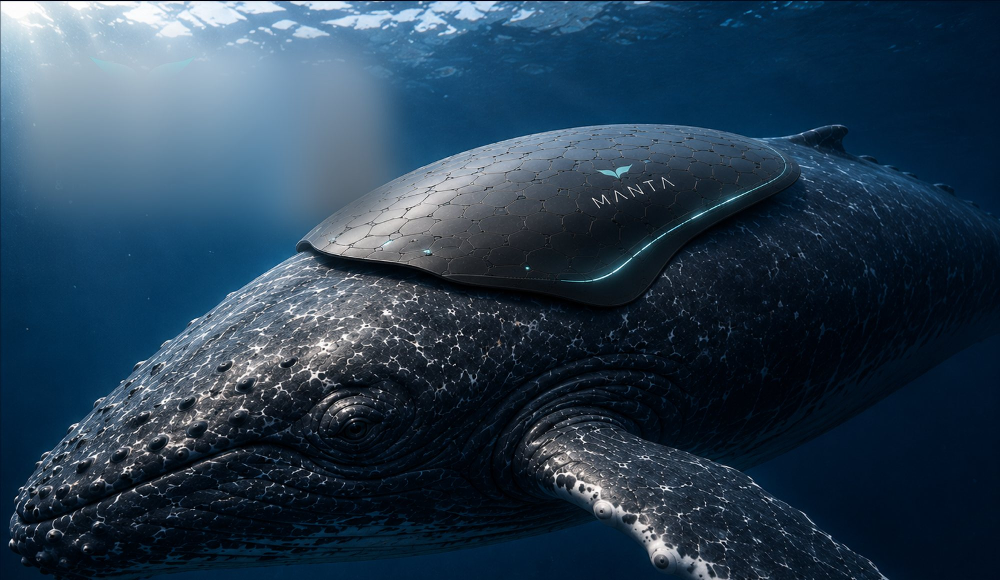

> ⚠️ **About the visuals:** all product and scene images in this project were **rendered using AI image-generation tools, for conceptualisation only**. They are meant to communicate the idea, form and context of the concept. MANTA is a speculative design and not a working, engineered or tested device.

---

## The challenge

**Oceans are becoming increasingly acidic.**

Every year, the ocean absorbs nearly one-third of human-generated carbon dioxide. This changes seawater chemistry, reducing pH and making it increasingly difficult for marine ecosystems to survive. As acidification spreads, corals weaken, shell-forming organisms struggle to build protective shells, and entire marine food webs become increasingly vulnerable.

## The concept

MANTA detects local chemical stress and delivers precise, minimal interventions only where needed. Data is recorded, transmitted and analysed to continuously improve decisions and outcomes.

**Capabilities**
- Continuous ocean pH monitoring
- Autonomous acidification detection
- Targeted pH neutralization
- Whale migration tracking
- Environmental data collection
- Precision chemical dispersion
- Ocean health mapping

## Why whales?

Whales naturally travel over **4,000–6,500 miles every year**, crossing some of the least monitored regions of the world's oceans. Their predictable migration makes them ideal mobile platforms for environmental sensing. Instead of introducing new infrastructure, MANTA works with an existing natural system.

---

## How it works

| Step | What happens |
|---|---|
| **1. Sense** | Sensors continuously measure pH, temperature, CO₂, salinity and more. |
| **2. Analyze** | Onboard AI analyses data in real time to identify stress zones. |
| **3. Decide** | The system predicts impact and decides the exact intervention needed. |
| **4. Neutralize** | A micro-dose of neutralizing compound is released only where needed. |
| **5. Verify** | Post-intervention data confirms improvement in local water quality. |
| **6. Transmit** | Data and outcomes are sent via satellite for global analysis. |

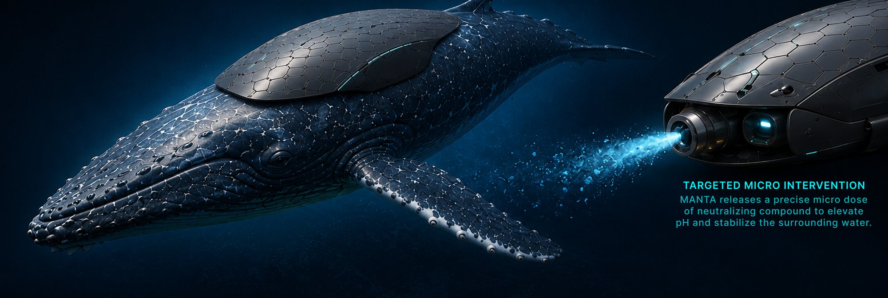

---

## Component dissection

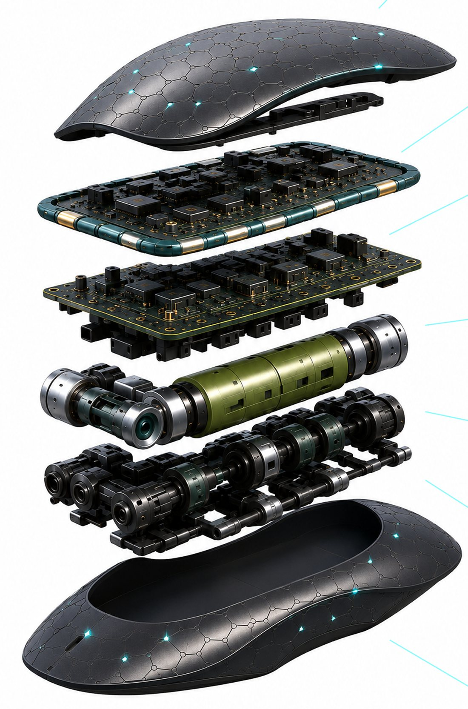

1. **Smart Skin**: flexible, solar-integrated outer layer; hydrodynamic and bio-inspired to move seamlessly with the whale.
2. **Communication Suite**: satellite uplink for real-time data transmission; low power, long range, connectivity anywhere in the ocean.
3. **AI & Control Core**: onboard AI for adaptive decision making, target selection and efficient power management.
4. **Sensor Suite**: multi-parameter sensors monitor water quality, pH, temperature, salinity, turbidity and dissolved oxygen.
5. **Neutralization Module**: micro-dose chemical cartridge that stores neutralizing compound for targeted interventions.
6. **Micro Pump Array**: precision micro pumps deliver exact doses with uniform dispersion and minimal waste.
7. **Hydrodynamic Base**: smooth, bio-inspired base for seamless attachment and natural movement with the whale.

---

## Multi-angle view

| Top | Rear |
|---|---|
| 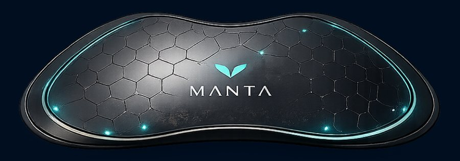 | 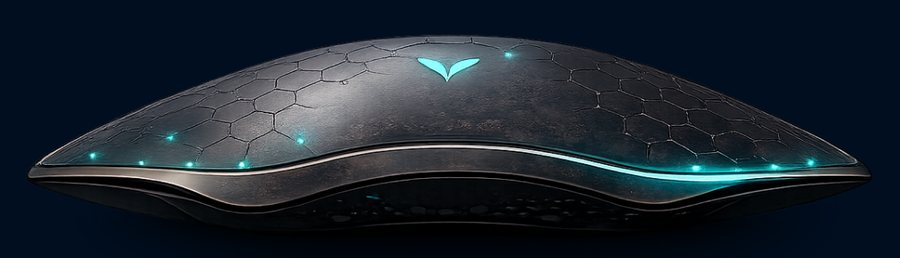 |
| **Side** | **Underside** |
| 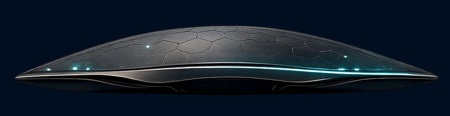 | 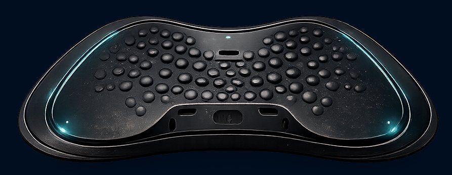 |

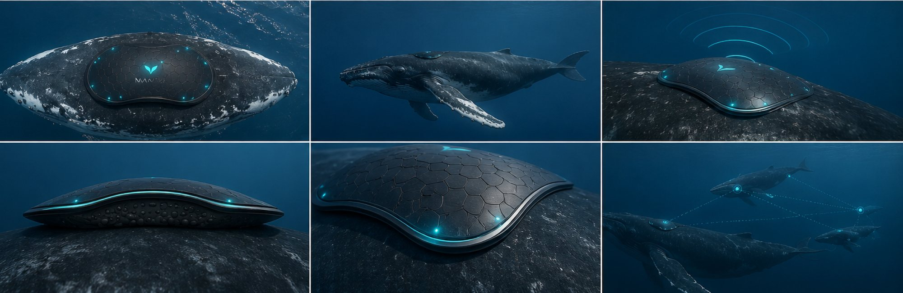

## Logo

The MANTA mark abstracts a whale's fluke into a single, fluid cyan form.

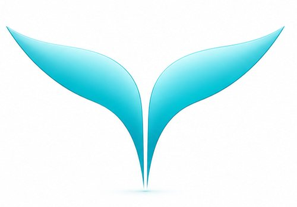

---

## Presentation boards

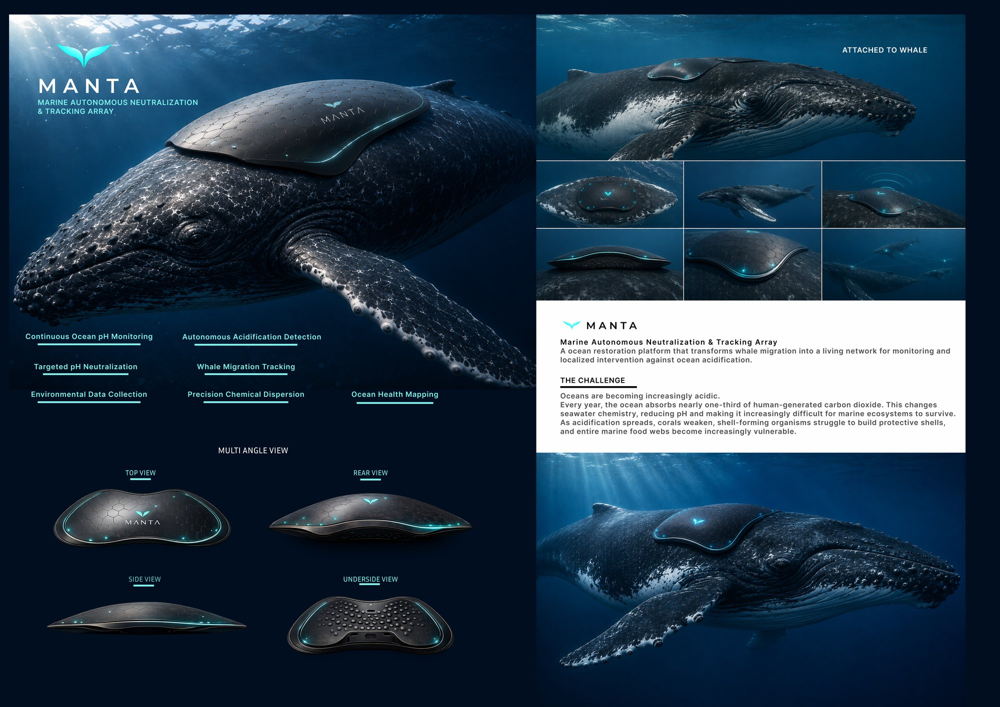
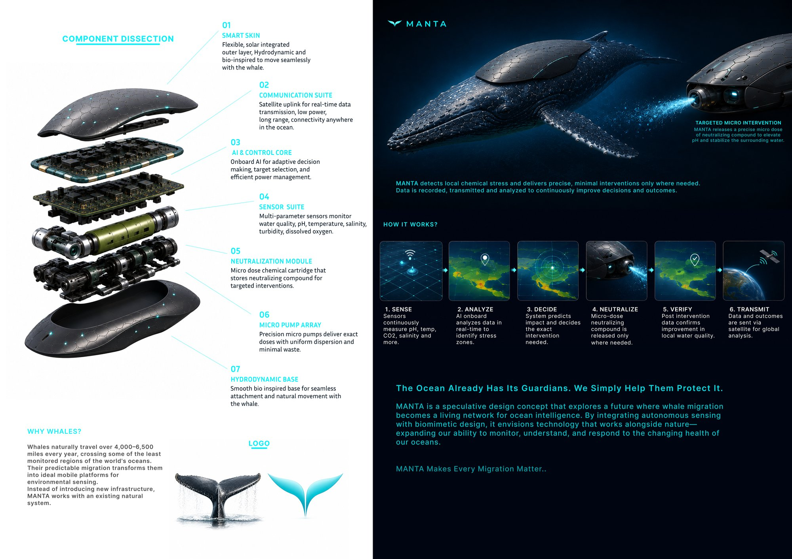

---

## Tools

- AI image-generation tools: concept renders (for conceptualisation only)
- Graphic layout of presentation boards
- HTML/CSS: project website

## Designer

**Preksha Anand**

*MANTA Makes Every Migration Matter.*
